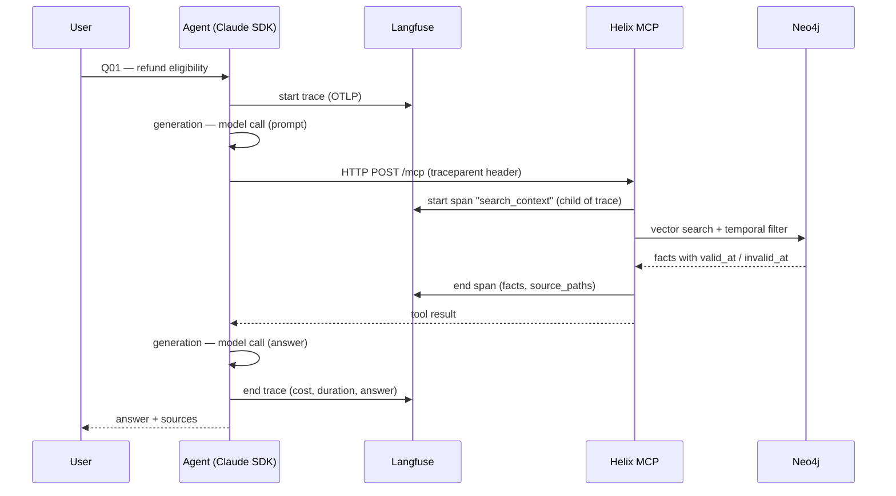

# 02 — Solution design

**Date:** 2026-11-04
**Status:** Final

## Chosen approach

**Option B — OTel on the agent + Langfuse SDK on Helix**

- Claude Agent SDK emits OTLP spans natively → pointed at Langfuse's OTLP endpoint
- Helix MCP server uses the Langfuse SDK to record tool and retriever observations
- `traceparent` header propagates automatically in HTTP calls from agent → MCP, linking both into one trace
- If Langfuse is down, OTLP fails silently and the agent keeps working (graceful degradation)

## Trace diagram (one question)

## Observation names

| Name | Type | What it records |
|---|---|---|
| `ask-orbisa` | trace | One full question → answer cycle |
| `agent` | span | Claude Agent SDK orchestration loop |
| `model-call` | generation | LLM call: prompt, response, tokens, cost |
| `search-context` | tool | MCP search_context call with query and as_of |
| `find-entities` | tool | MCP find_entities call |
| `read-source` | tool | MCP read_source call |
| `list-sources` | tool | MCP list_sources call |
| `neo4j-retrieval` | retriever | Vector search result: facts, statuses, sources |

Names are verb-first, lowercase, hyphenated — stable across prompt changes so evaluators and dashboards never break.

## Scores

| Score name | Maps to criterion | How computed |
|---|---|---|
| `correctness` | ≥ 90% on 22 questions | LLM judge: compares answer vs `expected_answer` → 0.0 or 1.0 |
| `has_trail` | 100% complete trail | Rule: trace has ≥ 1 retriever span with `source_path` and `valid_at` |
| `cost_usd` | ≤ USD 0.25 / question | Read from `result.total_cost_usd` on ResultMessage |
| `duration_ms` | ≤ 120s p95 | Read from `result.duration_ms` on ResultMessage |

## Dataset plan

Source: `data/orbisa/truth/questions.jsonl` — 22 questions, fields:
`id`, `question`, `as_of`, `expected_answer`, `expected_facts`, `expected_sources`, `category`, `trap`

Each question becomes one Langfuse dataset item. Experiment runs link each item to a trace,
allowing score comparison across runs (before/after a prompt change).

## Build increments

| # | Increment | Check |
|---|---|---|
| 1 | Trace Helix — instrument MCP tools with Langfuse SDK | Each tool call appears as a span in Langfuse UI |
| 2 | Trace agent with OTLP — configure SDK env vars | Agent spans appear; linked to Helix spans via traceparent |
| 3 | Link and enrich — one trace, sessions, users, masking | Single trace shows agent + Helix; no raw document content in spans |
| 4 | Prompt management — move system prompt to Langfuse | Prompt version visible on each trace; rollback works |
| 5 | Dataset and experiments — run 22 questions, score with LLM judge | Correctness score ≥ 90% visible in Langfuse Experiments |
| 6 | Online eval and human review — score live questions | New questions scored automatically; low-score traces flagged for review |
| 7 | Dashboards and alerts — ops view + agentic access | Cost/latency dashboard live; alert fires on quality drop |
